# datagokr DB Schema

> **Last Updated:** 2026-07-23
> PostgreSQL 17.4 (postgres-174) — NodePort 30433

---

## 테이블 목록

| 테이블 | 상태 | DDL | 설명 |
|--------|------|-----|------|
| `dcat_dataset` | ✅ 운영 중 | [sql/dcat_dataset.sql](../../sql/dcat_dataset.sql) | 데이터셋 전반 기술 (admin/user 생성 모두 포함) |
| `dcat_provenance` | ✅ 운영 중 | [sql/dcat_provenance.sql](../../sql/dcat_provenance.sql) | 수집 실행 이력 |
| `data_registry` | ✅ 운영 중 | [sql/data_registry.sql](../../sql/data_registry.sql) | 통합 운영정보 (저장소 위치, 운영 상태) |
| `dcat_dataset_vec` | ✅ 운영 중 | [sql/dcat_dataset_vec.sql](../../sql/dcat_dataset_vec.sql) | 데이터셋 description 임베딩 (pgvector 768차원) |
| `meta_youtube_video` | ✅ 생성 완료 | [sql/meta_youtube_video.sql](../../sql/meta_youtube_video.sql) | YouTube 영상 단위 메타 (Schema.org VideoObject). `has_transcript`/`transcribed_at` 컬럼 추가(2026-07-28) — 자체 STT 트랜스크립트 저장 여부, [architecture/05_Object_Storage_Export.md](../architecture/05_Object_Storage_Export.md) 참조 |
| `meta_youtube_video_vec` | ✅ 생성 완료 | [sql/meta_youtube_video_vec.sql](../../sql/meta_youtube_video_vec.sql) | YouTube 영상 임베딩 (pgvector 768차원) |
| `active_meta_youtube` | ✅ 생성 완료 | [sql/active_meta_youtube.sql](../../sql/active_meta_youtube.sql) | YouTube 영상 시계열 통계 (dataset+video 단위) |
| `meta_youtube_video_ai` | ⏳ 예정 | — | YouTube 영상 AI 생성 메타 (요약·키워드·개체명 등) |
| `meta_naver_news` | ✅ 생성 완료 | [sql/meta_naver_news.sql](../../sql/meta_naver_news.sql) | Naver 뉴스 기사 단위 메타 (Schema.org NewsArticle) |
| `meta_naver_news_vec` | ✅ 생성 완료 | [sql/meta_naver_news_vec.sql](../../sql/meta_naver_news_vec.sql) | Naver 뉴스 기사 임베딩 (pgvector 768차원) |
| `active_meta_naver_news` | ✅ 생성 완료 | [sql/active_meta_naver_news.sql](../../sql/active_meta_naver_news.sql) | Naver 뉴스 기사 시계열 통계 (댓글 수만 수집, [결정 배경](../adr/005_Naver_News_Metrics_Decision.md)) |
| `meta_naver_news_ai` | ⏳ 예정 (필드 후보만) | — | Naver 뉴스 기사 AI 생성 메타 |
| `meta_naver_shopping` | ✅ 생성 완료 | [sql/meta_naver_shopping.sql](../../sql/meta_naver_shopping.sql) | 쇼핑인사이트 카테고리 정적 정보 (source_type=shopping_insight). **`_vec` 임베딩 테이블 없음(의도적)** — 아래 각주 참조 |
| `active_meta_naver_shopping` | ✅ 생성 완료 | [sql/active_meta_naver_shopping.sql](../../sql/active_meta_naver_shopping.sql) | 일별 검색량 지수 (raw/normalized/pseudo_volume, 성별×연령) |
| `meta_naver_persona` | ✅ 생성 완료 | [sql/meta_naver_persona.sql](../../sql/meta_naver_persona.sql) | Persona 카테고리 정적 정보 (source_type=persona_insight). **`_vec` 임베딩 테이블 없음(의도적)** — 아래 각주 참조 |
| `active_meta_naver_persona` | ✅ 생성 완료 | [sql/active_meta_naver_persona.sql](../../sql/active_meta_naver_persona.sql) | 일별 Persona Index (gender_pv × age_pv, 독립 가정 추정치) |
| `meta_naver_blog` | ✅ 생성 완료 | [sql/meta_naver_blog.sql](../../sql/meta_naver_blog.sql) | Naver 블로그 게시물 단위 메타 (Schema.org BlogPosting) |
| `meta_naver_blog_vec` | ✅ 생성 완료 | [sql/meta_naver_blog_vec.sql](../../sql/meta_naver_blog_vec.sql) | Naver 블로그 게시물 임베딩 (pgvector 768차원) |
| `active_meta_naver_blog` | ✅ 생성 완료 | [sql/active_meta_naver_blog.sql](../../sql/active_meta_naver_blog.sql) | 반응(공감 등) 수 시계열 — [ADR-006](../adr/006_Naver_Blog_Metrics_Decision.md)으로 확정, 댓글 수·조회수는 미수집 |
| `meta_naver_blog_ai` | ⏳ 예정 (필드 후보만) | — | Naver 블로그 게시물 AI 생성 메타 |
| `dataset_credentials` | ✅ 운영 가능 (2026-07-28, 암호화 키 K8s Secret 생성+검증 완료) | [sql/dataset_credentials.sql](../../sql/dataset_credentials.sql) | 데이터셋별 API Key 암호화 저장 (pgcrypto). [설계 배경](../architecture/04_Collection_Pipeline_Operations.md#9-api-key-저장-모델--결정-데이터셋별-저장). **단, `register_dataset.py`에 API Key 입력 옵션이 아직 없어 실제로 쓰는 데이터셋은 아직 0건** |

> **shopping/persona에 `_vec` 임베딩 테이블이 없는 이유:** 카테고리 데이터(`category_name`)는
> 사람이 자유 텍스트로 검색할 대상이 아니라 구조화된 분류값이라 의미 기반(semantic) 검색의
> 효용이 낮다고 판단해 의도적으로 제외했다. 나중에 "이런 느낌의 카테고리 찾기" 같은 의미
> 검색 요구가 실제로 생기면 그때 추가한다.

---

## dcat_dataset — 데이터셋 생성 유형

`dcat_dataset`은 두 가지 방식으로 생성된다:

| `dataset_origin` | 생성 주체 | 생성 방식 | 예시 |
|-----------------|----------|----------|------|
| `'admin'` | 관리자 | 단일 채널/검색어/블로그 등록, 자동 수집 | YouTube 채널 1개, 뉴스 검색어 1개 |
| `'user'` | 사용자 | UI에서 직접 정의. 동일 소스 타입 내에서 복수 채널·영상·검색어 자유 조합 | YouTube: 채널 여러 개 + 개별 영상 선택 |

> **소스 타입 경계:** `dcat_dataset` 1개는 항상 단일 소스 타입(`source_type`)만 담는다.
> YouTube 영상 + 뉴스 기사를 하나의 데이터셋으로 혼합하는 것은 지원하지 않는다.

### source_type 목록

| `source_type` | 설명 | 관련 meta 테이블 |
|--------------|------|----------------|
| `video` | YouTube 영상 | meta_youtube_video |
| `news` | Naver 뉴스 기사 | meta_naver_news |
| `blog` | Naver 블로그 게시물 | meta_naver_blog |
| `shopping_insight` | Naver 쇼핑인사이트 (카테고리별 검색량, anchor+batch 호출) | meta_naver_shopping |
| `persona_insight` | Naver 쇼핑 Persona (성별/연령 독립 API 2종 호출 → persona_index) | meta_naver_persona |

---

## 테이블 관계

```
dcat_dataset (1)  ─── "무엇인가" (명세)
    │   dataset_origin: 'admin' | 'user'
    │
    ├──< dcat_provenance (N)         ─── "언제 어떻게 수집했나" (이력, 실행마다 INSERT)
    │                                     ON DELETE CASCADE
    │
    ├──  data_registry (1)           ─── "지금 어디 있고 상태는" (운영 현황, 실행마다 UPDATE)
    │                                     ON DELETE CASCADE
    │
    ├──  dcat_dataset_vec (1)        ─── "데이터셋 description 임베딩" (데이터셋 레벨 검색)
    │                                     ON DELETE CASCADE
    │
    ├──  dataset_credentials (N)     ─── "데이터셋별 API Key 암호화 저장" (pgcrypto)
    │                                     UNIQUE(dataset_id, credential_type)   ON DELETE CASCADE
    │
    ├──< meta_youtube_video (N)      ─── "YouTube 영상 단위 메타" (Schema.org VideoObject)
    │        UNIQUE(dataset_id, video_id)   ON DELETE CASCADE
    │        │
    │        ├──< active_meta_youtube (N)    ─── "시계열 통계 스냅샷" (dataset+영상 단위)
    │        │                                    ON DELETE CASCADE
    │        ├──  meta_youtube_video_vec (1) ─── "영상 임베딩" (영상 레벨 검색)
    │        │                                    ON DELETE CASCADE
    │        └──  meta_youtube_video_ai (1)  ─── "AI 생성 메타" (요약·키워드·개체명)
    │                                             ON DELETE CASCADE  [예정]
    │
    ├──< meta_naver_shopping (N)      ─── "쇼핑인사이트 카테고리" (source_type=shopping_insight)
    │        UNIQUE(dataset_id, category_id)   ON DELETE CASCADE
    │        │
    │        └──< active_meta_naver_shopping (N) ─── "일별 검색량 지수"
    │                                               raw/normalized/pseudo_volume × 성별×연령
    │                                               ON DELETE CASCADE
    │
    ├──< meta_naver_persona (N)       ─── "Persona 카테고리" (source_type=persona_insight)
    │        UNIQUE(dataset_id, category_id)   ON DELETE CASCADE
    │        │
    │        └──< active_meta_naver_persona (N) ─── "일별 Persona Index"
    │                                              gender_pv × age_pv (독립 가정 추정치)
    │                                              ON DELETE CASCADE
    │
    ├──< meta_naver_news (N)         ─── "Naver 뉴스 기사 단위 메타" (Schema.org NewsArticle)
    │        UNIQUE(dataset_id, article_url)   ON DELETE CASCADE
    │        │
    │        ├──< active_meta_naver_news (N)  ─── "댓글 시계열 스냅샷"
    │        │                                     is_naver_hosted=TRUE 기사만 행 존재
    │        │                                     ON DELETE CASCADE
    │        ├──  meta_naver_news_vec (1)      ─── "기사 임베딩" (기사 레벨 검색)
    │        │                                     ON DELETE CASCADE
    │        └──  meta_naver_news_ai (1)       ─── "AI 생성 메타" (요약·키워드·개체명 등)
    │                                             ON DELETE CASCADE  [예정]
    │
    └──< meta_naver_blog (N)         ─── "Naver 블로그 게시물 단위 메타" (Schema.org BlogPosting)
             UNIQUE(dataset_id, post_url)   ON DELETE CASCADE
             │
             ├──< active_meta_naver_blog (N)  ─── "반응(공감 등) 시계열 스냅샷" [ADR-006 확정]
             │                                     ON DELETE CASCADE
             ├──  meta_naver_blog_vec (1)      ─── "게시물 임베딩" (게시물 레벨 검색)
             │                                     ON DELETE CASCADE
             └──  meta_naver_blog_ai (1)       ─── "AI 생성 메타" (요약·키워드·개체명 등)
                                                   ON DELETE CASCADE  [예정]
```

### ERD

위 ASCII 다이어그램의 주석·설계 의도를 뺀, 표준 ER 다이어그램 형태 (GitHub에서 렌더링됨).
`_ai` 테이블은 아직 DDL이 없어 점선으로 표시.

```mermaid
erDiagram
    dcat_dataset ||--o{ dcat_provenance : "실행 이력"
    dcat_dataset ||--|| data_registry : "운영 현황"
    dcat_dataset ||--|| dcat_dataset_vec : "임베딩"
    dcat_dataset ||--o{ dataset_credentials : "API Key"
    dcat_dataset ||--o{ meta_youtube_video : "영상"
    dcat_dataset ||--o{ meta_naver_shopping : "쇼핑 카테고리"
    dcat_dataset ||--o{ meta_naver_persona : "Persona 카테고리"
    dcat_dataset ||--o{ meta_naver_news : "뉴스 기사"
    dcat_dataset ||--o{ meta_naver_blog : "블로그 게시물"

    meta_youtube_video ||--o{ active_meta_youtube : "시계열"
    meta_youtube_video ||--|| meta_youtube_video_vec : "임베딩"
    meta_youtube_video ||..o| meta_youtube_video_ai : "AI 메타 (예정)"

    meta_naver_shopping ||--o{ active_meta_naver_shopping : "일별 지수"
    meta_naver_persona ||--o{ active_meta_naver_persona : "일별 Persona Index"

    meta_naver_news ||--o{ active_meta_naver_news : "댓글 시계열"
    meta_naver_news ||--|| meta_naver_news_vec : "임베딩"
    meta_naver_news ||..o| meta_naver_news_ai : "AI 메타 (예정)"

    meta_naver_blog ||--o{ active_meta_naver_blog : "반응 시계열 (ADR-006)"
    meta_naver_blog ||--|| meta_naver_blog_vec : "임베딩"
    meta_naver_blog ||..o| meta_naver_blog_ai : "AI 메타 (예정)"

    dcat_dataset {
        text dataset_id PK
        text title
        text source_type
        text dataset_origin
        text owner_id "FK 예정, 계정테이블 미정"
        bigint item_count
    }
    dataset_credentials {
        text dataset_id FK
        text credential_type
        bytea encrypted_value
    }
    meta_youtube_video {
        bigint id PK
        text dataset_id FK
        text video_id
        boolean is_removed
    }
    meta_naver_shopping {
        bigint id PK
        text dataset_id FK
        text category_id
        boolean is_anchor
    }
    meta_naver_persona {
        bigint id PK
        text dataset_id FK
        text category_id
    }
    meta_naver_news {
        bigint id PK
        text dataset_id FK
        text article_url
        boolean is_naver_hosted
        boolean is_removed
    }
    meta_naver_blog {
        bigint id PK
        text dataset_id FK
        text post_url
        text platform
        boolean is_removed
    }
```



### 벡터 검색 2레벨

| 레벨 | 테이블 | 질의 예시 |
|------|--------|---------|
| 데이터셋 레벨 | `dcat_dataset_vec` | "반도체 관련 데이터셋 찾기" (소스 타입 무관) |
| 영상 레벨 | `meta_youtube_video_vec` | "HBM 공정 설명하는 영상 찾기" |
| 기사 레벨 | `meta_naver_news_vec` | "HBM4 관련 최신 기사 찾기" |
| 게시물 레벨 | `meta_naver_blog_vec` | "HBM 반도체 후기 블로그 찾기" |

### active_meta 설계 포인트

같은 영상(video_id)이 Dataset A, Dataset B에 동시에 포함될 수 있다.
`active_meta_youtube`는 `meta_youtube_video.id` (= dataset+video 조합)를 기준으로 추적하므로
각 데이터셋이 독립적인 수집 타임라인과 delta를 갖는다.

```
예시: video_id=abc123 이 두 데이터셋에 포함

meta_youtube_video
  id=1  dataset_id=samsung_ch      video_id=abc123
  id=2  dataset_id=hbm_collection  video_id=abc123

active_meta_youtube
  meta_id=1  collected_at=07-07 월  view_count=10,000  delta=NULL   ← Dataset A 첫 수집
  meta_id=2  collected_at=07-09 수  view_count=10,500  delta=NULL   ← Dataset B 첫 수집 (독립 시작)
  meta_id=1  collected_at=07-14 월  view_count=12,000  delta=+2,000 ← Dataset A 기준 정확한 delta
  meta_id=2  collected_at=07-16 수  view_count=12,800  delta=+2,300 ← Dataset B 기준 정확한 delta
```

---

## AI 메타데이터 파이프라인 (예정)

`meta_youtube_video_ai`/`meta_naver_news_ai`/`meta_naver_blog_ai` 공통 설계. 수집 코드
완성 후 성능 테스트를 거쳐 도입 — 아직 DDL 없음(필드 후보만 정리된 상태).

> **⚠️ 설계 제약 (2026-07-23 확정): 이 프로젝트를 위한 별도 학습·파인튜닝은 하지 않는다.**
> 그럴 시간이 없다. 대신 이미 학습이 끝난 오픈소스 모델을 그대로 가져다 쓰는 것은 전부
> 허용 — Groq API로 호출하는 LLM(Llama/Gemma 등) 프롬프트 방식이든, HuggingFace의
> 사전학습 BERT 계열 분류기/NER/감성분석 모델이든 상관없다. 필드별로 어느 쪽이 더
> 정확할지는 실제 구현 단계에서 후보 모델 몇 개를 붙여보고 고르면 된다 — 아래 필드
> 목록은 "학습 없이 뽑아낼 수 있는가"만 기준으로 추렸고, "어떤 모델로"는 구현 시 결정.

### 처리 흐름 (YouTube 예시)

```
트랜스크립트 (youtube-transcript-api)
    ↓ 전처리 (타임스탬프 제거, 줄 합치기)
    ↓
사전학습 모델 호출 (Groq LLM 프롬프트 또는 HuggingFace 사전학습 모델 — 필드별로 선택)
    ↓
meta_youtube_video_ai INSERT
```

뉴스/블로그는 `active_meta`처럼 소스별 시계열 통계 컬럼은 다르지만, AI 파이프라인
자체는 "본문 텍스트 → 사전학습 모델 → INSERT" 구조가 동일하다. YouTube만 트랜스크립트
대신 썸네일 이미지를 쓰는 비전 모델 경로가 추가로 있다.

### YouTube — `meta_youtube_video_ai` (트랜스크립트 + 썸네일)

기존에 트랜스크립트 기반 5개 필드만 정리돼 있었는데, `research/paper_topics.md`
연구주제 #6(VLM 썸네일 메타데이터)에서 이미 제안된 썸네일 기반 4개 필드가 이 문서엔
반영이 안 돼 있었다 — 아래 표로 통합.

| 필드 | 설명 | 입력 소스 |
|------|------|----------|
| `ai_summary` | 3문장 이내 요약 | 트랜스크립트 |
| `ai_keywords` | 핵심 키워드 배열 | 트랜스크립트 |
| `ai_entities` | 등장 기관·인물·제품명 (JSONB) | 트랜스크립트 |
| `ai_content_type` | tutorial / review / presentation / interview / news | 트랜스크립트 |
| `ai_key_points` | 핵심 포인트 bullet 배열 | 트랜스크립트 |
| `ai_visual_summary` | 썸네일 시각 요약 | 썸네일 (VLM, 예: LLaVA 계열) |
| `ai_dominant_objects` | 썸네일에 등장하는 주요 객체 (JSONB) | 썸네일 |
| `ai_visual_emotion` | 썸네일이 유발하는 감정 톤 | 썸네일 |
| `ai_layout_type` | 썸네일 레이아웃 유형 (얼굴클로즈업/스크린샷/텍스트오버레이 등) | 썸네일 |

트랜스크립트 없는 영상은 title+description으로 fallback(위 5개 필드), 썸네일
4개 필드는 트랜스크립트 유무와 무관하게 항상 추출 가능. 상세 연구 설계는
[research/paper_topics.md](../research/paper_topics.md) #3, #6 참조.

### 뉴스 — `meta_naver_news_ai` (신규 제안, 필드 확정 전)

이 프로젝트가 반도체·AI 등 산업 뉴스를 주로 다루는 걸 감안한 후보 필드.

| 필드 | 설명 | 입력 소스 |
|------|------|----------|
| `ai_summary` | 3문장 이내 요약 | 기사 본문 |
| `ai_keywords` | 핵심 키워드 배열 | 기사 본문 |
| `ai_entities` | 등장 기관·인물·기업명 (JSONB) | 기사 본문 — LLM 프롬프트 또는 사전학습 한국어 NER 모델 |
| `ai_related_companies` | 언급된 기업명 목록 (JSONB) | 기사 본문 — 산업 동향 분석 연결 목적 |
| `ai_sentiment` | 기사 톤(긍정/중립/부정) | 기사 본문 — LLM 또는 사전학습 감성분석 모델, 특정 기업·이슈 여론 추적용 |
| `ai_topic_category` | 산업/정치/사회/기술 등 분류 | 기사 본문 |
| `ai_is_opinion` | 사실 보도 vs 사설·의견 구분 | 기사 본문 |

`has_content=FALSE`(스크래핑 실패) 기사는 title+description으로 fallback.

### 블로그 — `meta_naver_blog_ai` (신규 제안, 필드 확정 전)

시드 데이터도 리뷰/후기 위주("3주 사용 후기" 등)라 리뷰 콘텐츠 특성에 맞춘 후보 필드.

| 필드 | 설명 | 입력 소스 |
|------|------|----------|
| `ai_summary` | 3문장 이내 요약 | 게시물 본문 |
| `ai_keywords` | 핵심 키워드 배열 | 게시물 본문 |
| `ai_content_type` | 리뷰/정보성/협찬(광고)/일상 분류 | 게시물 본문 |
| `ai_sponsored_likelihood` | 협찬(광고) 콘텐츠 여부 추정 | 게시물 본문 — 법정 고지 문구("소정의 원고료" 등) 패턴 탐지 + 모델 판단 병행, 블로그 신뢰도 판단에 중요 |
| `ai_product_mentions` | 언급된 제품·브랜드명 (JSONB) | 게시물 본문 — shopping_insight 데이터와 교차분석 가능 |
| `ai_sentiment` | 리뷰 톤(긍정/중립/부정) | 게시물 본문 |
| `ai_pros_cons` | 장단점 목록 (JSONB, 리뷰 글 한정) | 게시물 본문 |

`has_content=FALSE`(스크래핑 실패) 게시물은 title+description으로 fallback.

### 인프라 결정 사항 (공통)

| 항목 | 결정 |
|------|------|
| 처리 방식 | 사전학습된 오픈소스 모델만 사용 — Groq API 경유 LLM 프롬프트, HuggingFace 사전학습 분류기/NER/감성분석 모델 모두 후보 |
| 이유 | 서버(RnD-analyzer01) GPU 없음 — 로컬 대형 LLM은 실용 불가하나 경량 HuggingFace 모델은 CPU로도 가능. 학습 데이터 구축·파인튜닝 시간도 없음 |
| 모델 선택 기준 | 필드별로 구현 단계에서 후보 몇 개 비교 후 결정 — LLM 프롬프트 vs 사전학습 전용 모델 |
| 본문/트랜스크립트 없는 경우 | title + description으로 fallback, ai 테이블 row 없을 수 있음 |
| 정확도가 낮은 필드 처리 | 프롬프트 개선 또는 다른 사전학습 모델로 교체, 파인튜닝 검토 안 함 |

---

## 뷰 (Views)

| 뷰 이름 | DDL | 설명 |
|---------|-----|------|
| `v_meta_youtube_latest` | [sql/views.sql](../../sql/views.sql) | meta_youtube_video + active_meta_youtube 최신 row 결합. 영상별 현재 통계(최신 수집값 + 전회차 증감)를 한 번에 조회 |
| `v_meta_naver_news_latest` | [sql/views.sql](../../sql/views.sql) | meta_naver_news + active_meta_naver_news 최신 row 결합. 기사별 댓글 통계(최신 수집값 + 전회차 증감)를 한 번에 조회. 외부 기사 댓글 컬럼 NULL |
| `v_meta_naver_blog_latest` | [sql/views.sql](../../sql/views.sql) | meta_naver_blog + active_meta_naver_blog 최신 row 결합. 게시물별 반응(공감 등) 통계(최신 수집값 + 전회차 증감)를 한 번에 조회. platform≠'naver' 게시물은 반응 컬럼 NULL(ADR-006). 2026-07-31 추가 |
| `v_meta_naver_shopping_latest` | [sql/views.sql](../../sql/views.sql) | "최신 날짜 스냅샷" — 카테고리별 max(period)의 12조합(성별 m/f × 연령 10~60) pseudo_volume/normalized_ratio. 카테고리당 12행(다차원 시계열이라 "최신 1행"이 성립 안 함). 전체('') 집계는 제외. 2026-07-31 추가 |
| `v_meta_naver_persona_latest` | [sql/views.sql](../../sql/views.sql) | "최신 날짜 스냅샷" — 카테고리별 max(period)의 12조합 persona_index/gender_pv/age_pv. 카테고리당 12행. 2026-07-31 추가 |

---

## DDL 적용 순서

전체 재구성 시 아래 순서로 실행 (`dcat_dataset.sql`이 CASCADE로 자식 테이블을 먼저 삭제함):

```bash
# 1. 핵심 테이블 생성 (부모 → 자식 순서)
psql -h localhost -p 30433 -U admin -d datagokr \
  -f sql/dcat_dataset.sql \
  -f sql/dcat_provenance.sql \
  -f sql/data_registry.sql \
  -f sql/dcat_dataset_vec.sql \
  -f sql/dataset_credentials.sql

# 2. YouTube 메타 테이블 생성
psql -h localhost -p 30433 -U admin -d datagokr \
  -f sql/meta_youtube_video.sql \
  -f sql/active_meta_youtube.sql \
  -f sql/meta_youtube_video_vec.sql

# 3. Naver 뉴스 메타 테이블 생성
psql -h localhost -p 30433 -U admin -d datagokr \
  -f sql/meta_naver_news.sql \
  -f sql/meta_naver_news_vec.sql \
  -f sql/active_meta_naver_news.sql

# 4. Naver 쇼핑·Persona 메타 테이블 생성
psql -h localhost -p 30433 -U admin -d datagokr \
  -f sql/meta_naver_shopping.sql \
  -f sql/active_meta_naver_shopping.sql \
  -f sql/meta_naver_persona.sql \
  -f sql/active_meta_naver_persona.sql

# 5. Naver 블로그 메타 테이블 생성 (active_meta_naver_blog는 ADR-006으로 반응 수 수집 확정)
psql -h localhost -p 30433 -U admin -d datagokr \
  -f sql/meta_naver_blog.sql \
  -f sql/meta_naver_blog_vec.sql \
  -f sql/active_meta_naver_blog.sql

# 6. 샘플 데이터 삽입 (개발용)
psql -h localhost -p 30433 -U admin -d datagokr \
  -f sql/seeds.sql

# 7. 뷰 생성
psql -h localhost -p 30433 -U admin -d datagokr \
  -f sql/views.sql

# 8. 임베딩 생성
python scripts/embed_datasets.py         # dcat_dataset_vec
python scripts/embed_youtube_videos.py   # meta_youtube_video_vec
python scripts/embed_naver_news.py       # meta_naver_news_vec
python scripts/embed_naver_blog.py       # meta_naver_blog_vec
```

---

## 미결정 사항 / 다음 작업

기본 데이터 설계(dcat_dataset → meta → active_meta → _vec, YouTube/뉴스/쇼핑/Persona/블로그)의
스키마 레벨은 완성됐다. 남은 작업(미검증 항목, 실제 DB 반영 절차, 필요한 추가 테이블/컬럼
리스트 등)은 **[NEXT_STEPS.md](../NEXT_STEPS.md)에서 통합 관리한다** — 이 문서에 중복
기록하면 두 문서가 서로 어긋날 위험이 있어, 여기서는 스키마 자체(테이블 목록·ERD·DDL
순서)만 유지하고 "무엇을 언제 할지"는 NEXT_STEPS.md 하나로 모은다.

---
